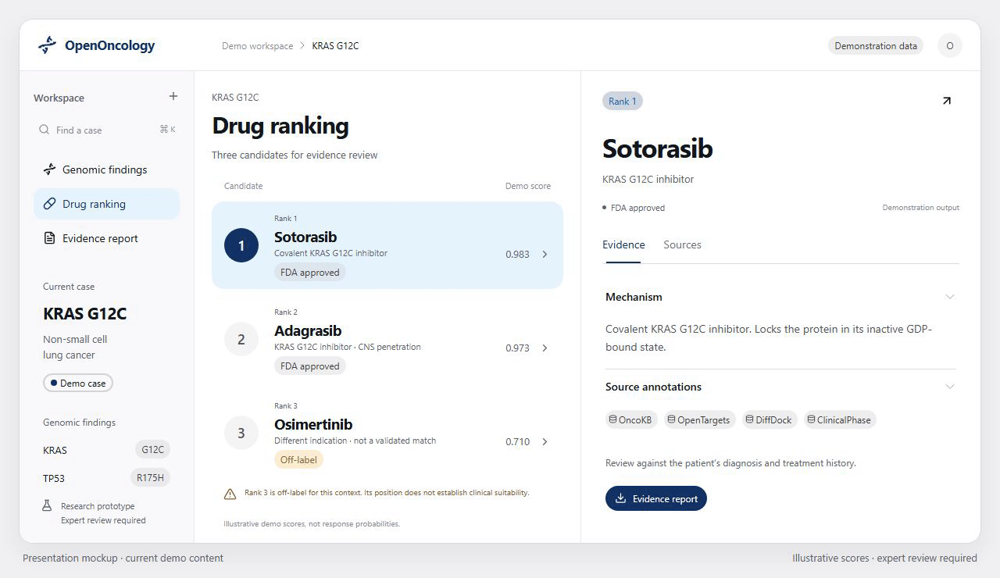

# OpenOncology

Open-source drug evidence matching for sequencing labs and oncologists.

[](https://github.com/immortal71/openoncology/actions/workflows/ci.yml)  [](https://github.com/immortal71/openoncology/blob/main/LICENSE)

[Explore cases](https://immortal71.github.io/openoncology/) · [Documentation](docs/README.md) · [Papers](#papers) · [Vision](VISION.md) · [Contributing](CONTRIBUTING.md)



*Presentation mockup using current demonstration content. The layout differs from the running app; scores are illustrative. [Watch with playback controls](docs/assets/showcase-demo.mp4) · [Static view](docs/assets/showcase-poster.png)*

OpenOncology assembles a ranked drug shortlist and evidence annotations from tumor genomic findings. The initial focus is sequencing labs that need oncology interpretation support; hospitals without molecular tumor boards come next.

The repository is a research prototype. Results require oncologist review. The [current product scope](docs/PRODUCT_SCOPE.md) explains what works today and what remains in development.

## Papers

**Retrospective benchmark on 2,505 MSK CHORD patients**

*A retrospective benchmark of an open-source oncology drug ranker on 2,505 MSK CHORD patients.*

[Read the preprint](https://www.researchsquare.com/article/rs-11584932/v1) · [DOI: 10.21203/rs.3.rs-11584932/v1](https://doi.org/10.21203/rs.3.rs-11584932/v1) · [Repository manuscript](preprints/msk_chord_benchmark.md)

This study evaluates a separate evidence-lookup runner using alterations selected from received treatments. It does not evaluate the complete application workflow or establish clinical benefit.

**Original framework paper**

*OpenOncology: An Open-Source Framework for Evidence-Based Drug Matching and De Novo Custom Drug Discovery in Precision Oncology.*

[Read the preprint](https://www.researchsquare.com/article/rs-9707913/v1) · [DOI: 10.21203/rs.3.rs-9707913/v1](https://doi.org/10.21203/rs.3.rs-9707913/v1) · [Corrections and reconciliation](docs/PAPER_VS_CURRENT_STATE.md)

The original paper describes the broader research agenda. Its discovery work is separate from the initial lab offering. Both works are preprints; see the [research guide](docs/RESEARCH.md) for their context and corrections.

## Review a case

1. Supply genomic findings and cancer context.
2. Inspect candidate drugs, evidence annotations and missing information.
3. Have an oncologist interpret the report against diagnosis and treatment history.

The prototype accepts genomic files including VCF. A complete lab integration remains in development. The [case walkthrough](docs/PATIENT_WALKTHROUGH.md) follows the handoff from a lab to the clinical team.

## Evaluation

The saved MSK CHORD experiment contains 2,505 selected patients:

| Measure | Result |
| --- | ---: |
| Patients with a prediction | 2,466 / 2,505 (98.4%) |
| Exact received drug in the top three, all selected patients | 2,094 / 2,505 (83.6%) |
| Exact received drug in the top three, patients with a prediction | 2,094 / 2,466 (84.9%) |

[Protocol, baseline and limitations](docs/BENCHMARK.md#msk-chord-evidence-lookup-benchmark) · [Historical evaluations](docs/RESEARCH.md)

## Run locally

Install Docker with Compose, then clone the repository and prepare its configuration:

```bash
git clone https://github.com/immortal71/openoncology.git
cd openoncology
cp .env.example .env
```

Review the credentials and service settings in the [setup guide](docs/SETUP.md#4-environment-variables), then start the stack:

```bash
docker compose up --build
```

Open the web app at `http://localhost:3000` and the API reference at `http://localhost:8000/docs`. The setup guide also covers Windows and development without Docker.

## What comes next

The next priorities are a hosted lab evaluation workspace, stronger integration of genomic findings, local drug availability and affordability data, and independent oncologist review. Initial clinical evaluation is planned in Nepal.

Hospital expansion depends on validation of the lab workflow and evaluation at each site. Multi-omics, federated learning and discovery research remain longer-term directions without a committed schedule.

[Vision](VISION.md) · [Roadmap](docs/ROADMAP.md)

## Build with us

The stack uses Next.js, FastAPI, Celery, PostgreSQL, MinIO and Nextflow. Start with the [architecture guide](docs/ARCHITECTURE.md) or [contribution guide](CONTRIBUTING.md).

[Report an issue](https://github.com/immortal71/openoncology/issues) · [Code of conduct](CODE_OF_CONDUCT.md) · [MIT license](LICENSE)

Backend coverage gate: **≥52%**. Evidence databases have separate access and licensing terms. Clinical deployment requires site validation and an appropriate regulatory assessment.
