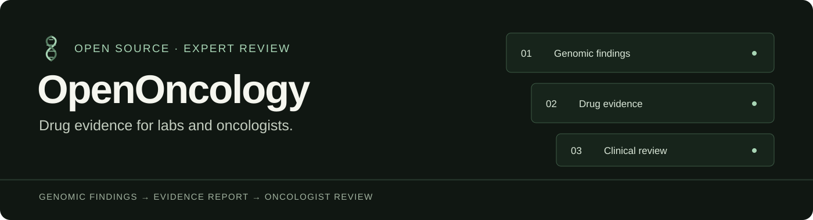
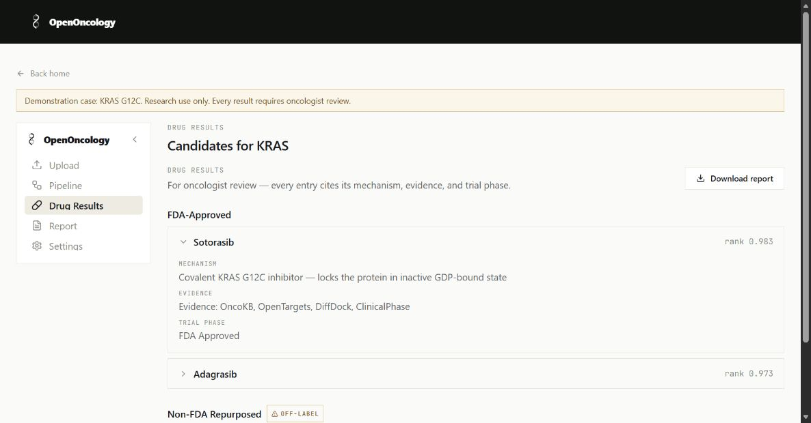
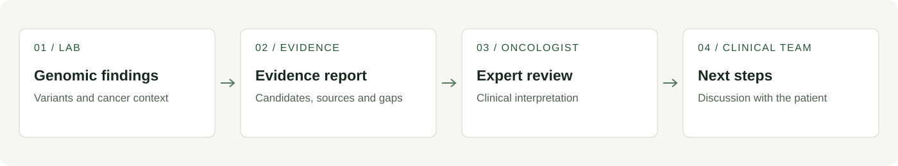
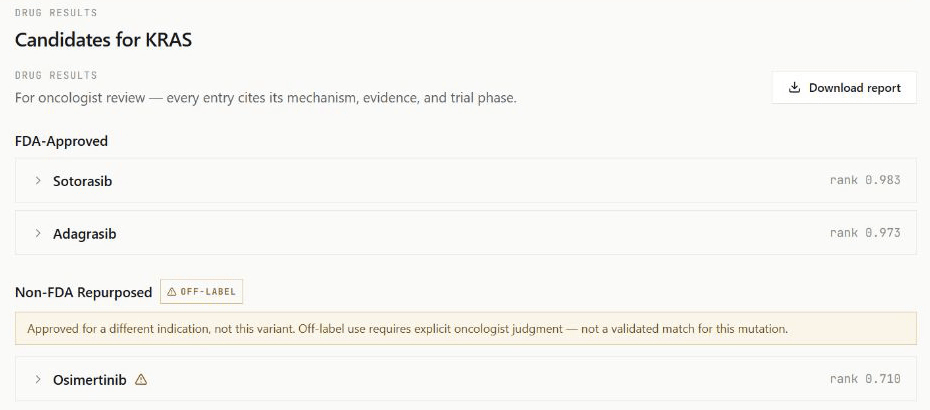

<p align="center">
  
</p>

# OpenOncology

OpenOncology helps interpret tumor genomic findings by assembling a ranked drug shortlist with evidence sources for an oncologist to review.

<p>
  <a href="https://github.com/immortal71/openoncology/actions/workflows/ci.yml"></a>
  <a href="https://github.com/immortal71/openoncology/actions/workflows/codeql.yml"></a>
  = 52%"/>
  <a href="https://github.com/immortal71/openoncology/blob/main/LICENSE"></a>
</p>

[Demo](https://immortal71.github.io/openoncology/) · [Documentation](docs/README.md) · [Vision](VISION.md) · [Contributing](CONTRIBUTING.md) · [Code of conduct](CODE_OF_CONDUCT.md)



*Actual frontend, demonstration data. The displayed scores are illustrative demo output.*

## Why it exists

A tumor's genetic findings do not explain which treatment evidence matters for a patient. That interpretation takes specialist time, and many hospitals do not have a molecular tumor board.

Our first target customers are sequencing labs that already produce genomic reports but need oncology interpretation support. Hospitals without molecular tumor boards come next. Initial clinical evaluation is planned in Nepal, where drug access and cost are central to the problem.

## What the product does

- Looks up drug evidence for genomic findings and cancer context.
- Ranks candidate drugs and provides evidence annotations and source references.
- Produces a report for an oncologist to review, including gaps in the available information.
- Supports self-hosting with publicly available code.

The repository is a research prototype. A hosted offering, local availability and affordability data, and site validation are planned. No paying customers or hospital deployments are reported. See [product scope](docs/PRODUCT_SCOPE.md) for implementation details and current limits.

## How a case moves through the workflow



The current prototype accepts genomic files, including VCF. A complete lab integration remains in development. The clinical team checks the result against the patient's diagnosis and treatment history; a missing match remains a gap for expert review. See the [case walkthrough](docs/PATIENT_WALKTHROUGH.md).

## Review the evidence

Expand a candidate to read its mechanism and evidence annotations. This short loop uses actual captures of the demonstration workspace.



[Static evidence-review view](docs/assets/evidence-review.jpg) · [Media and capture details](docs/MEDIA.md)

## Evaluation

The current MSK CHORD evaluation uses a retrospective cohort from Memorial Sloan Kettering. The committed results cover 2,505 patients selected under the benchmark's drug-to-alteration rules.

| Measure | Result |
|:--|--:|
| Patients with a prediction | 2,466 / 2,505 (98.4%) |
| Exact drug received in the top three, all selected patients | 2,094 / 2,505 (83.6%) |
| Exact drug received in the top three, patients with a prediction | 2,094 / 2,466 (84.9%) |

This evaluates evidence lookup using alterations selected from received treatments. It does not validate the complete application workflow or establish clinical benefit. The [evaluation reference](docs/BENCHMARK.md#msk-chord-evidence-lookup-benchmark) explains the protocol, baseline and limits; the [research guide](docs/RESEARCH.md) separates this work from historical studies.

## Getting started

For a quick look at saved research cases, open the [case explorer](https://immortal71.github.io/openoncology/). It displays benchmark outputs, not a hosted clinical service.

To run the stack locally, install Docker with Compose, clone the repository and prepare the environment file:

```bash
git clone https://github.com/immortal71/openoncology.git
cd openoncology
cp .env.example .env
```

Review the credentials and service settings in the [setup guide](docs/SETUP.md#4-environment-variables), then start the stack:

```bash
docker compose up --build
```

The web app runs at [localhost:3000](http://localhost:3000); the API reference is at [localhost:8000/docs](http://localhost:8000/docs). Setup also covers local Python/Node.js development, evidence credentials and Windows instructions. The [Vercel guide](docs/DEPLOY_VERCEL_DEMO.md) covers the demo frontend.

## Architecture and development

| Component | Stack |
|:--|:--|
| Web workspace | Next.js, React, TypeScript |
| API and reports | Python, FastAPI |
| Background processing | Celery, Redis |
| Storage | PostgreSQL, MinIO |
| Genomic preprocessing | Nextflow |

Source is organised under [`web/`](web/), [`api/`](api/) and [`pipeline/`](pipeline/). [Architecture](docs/ARCHITECTURE.md) covers components and data flow; [methods](docs/METHODS.md) describes the application ranker. The CHORD experiment uses a separate lookup runner.

Contributors can run `make help`, `make lint` and `make test` in a POSIX shell, including Git Bash on Windows. See [CONTRIBUTING.md](CONTRIBUTING.md) for environment setup, separate Python test suites and scientific-review requirements. Bug reports and contributions belong in [GitHub issues](https://github.com/immortal71/openoncology/issues) and pull requests.

## Future expansion

The next product work is a hosted evaluation workspace for labs, stronger integration of genomic findings, and local drug availability and affordability beside the evidence. Independent oncologist review and prospective evaluation will guide deployment.

After validation of the initial lab workflow, the plan is to offer hospitals a hosted workspace with support and validation at each site. Evaluation in Nepal will help establish what needs to change for resource-limited settings.

Multi-omics, federated learning, mobile access and discovery research are longer-term directions without a committed schedule. Discovery briefs, marketplace and crowdfunding code remain separate experiments. They are outside the initial offering and do not establish a path to manufacture a patient-specific treatment.

Read the [Vision](VISION.md) and [expansion roadmap](docs/ROADMAP.md) for the direction, priorities and evidence needed before moving forward.

## License and intended use

The code is available under the [MIT license](LICENSE). Evidence databases have their own access and licensing terms.

OpenOncology is research-use software. Every result requires independent review by a qualified oncologist. It has not been submitted for FDA clearance or CE marking. Clinical deployment requires site validation and an appropriate regulatory assessment.
