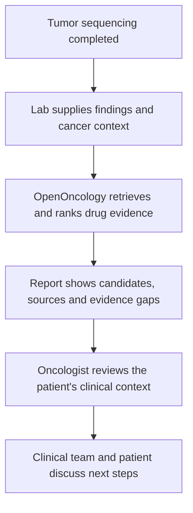

# Case walkthrough

The initial workflow begins with a tumor that has already been sequenced. A lab supplies the genomic findings, OpenOncology assembles the drug evidence, and an oncologist reviews the report before deciding next steps with the patient.

## 1. The lab supplies the findings

The lab provides genomic findings and cancer context. The prototype accepts genomic files, including VCF, and currently requires a biopsy attachment. A complete lab integration remains in development. Accepting a file extension does not establish support for interpreting every genetic-report format.

## 2. OpenOncology assembles the evidence

Evidence services look up candidate drugs for the supplied findings. An OncoKB token enables live lookup; the committed static table supports operation without a token. Other services contribute evidence or candidates where configured.

The report must distinguish evidence that was checked from a lookup that failed. An empty result is a gap for expert review, not evidence that no treatment exists.

## 3. The oncologist reviews the report

The reviewing clinician checks candidate drugs against the alteration and cancer context, reads the evidence sources and considers resistance and missing information. A drug's approval for some use does not establish that it is appropriate for this patient.

The shortlist supports this review. It does not provide a prescription or replace a molecular tumor board.

## 4. The clinical team discusses next steps

The clinical team considers the evidence alongside diagnosis, treatment history and the patient's circumstances. The clinician and patient decide what happens next.

Local drug availability and affordability are planned additions to the report. Today, a listed drug is not confirmation that the patient can obtain or afford it. Discovery, manufacture and crowdfunding are outside the initial workflow.

## Current implementation limits

The application's primary candidate path starts with the first targetable mutation. Comprehensive ranking across all relevant alterations needs further work. Copy-number and fusion handling in the CHORD benchmark is separate from integration through the normal upload flow. Treatment-line collection and handoff are also incomplete.

The [case explorer](https://immortal71.github.io/openoncology/) displays saved benchmark outputs. It does not run a prospective clinical assessment. See [product scope](PRODUCT_SCOPE.md) for implementation status and [evaluation methods](BENCHMARK.md#msk-chord-evidence-lookup-benchmark) for what the benchmark measures.

The [historical KRAS worked illustration](https://github.com/immortal71/openoncology/blob/cdff27f20ce86c651be3cb0944f7ec755b6e2cb1/docs/PATIENT_WALKTHROUGH.md) remains in Git history. Its illustrative report is not current, verified application output.
